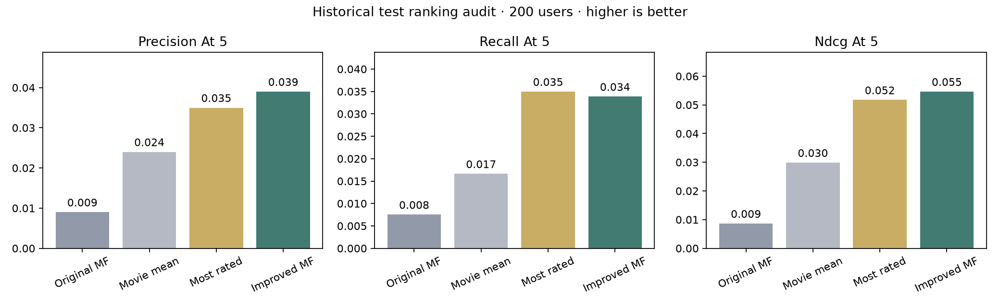
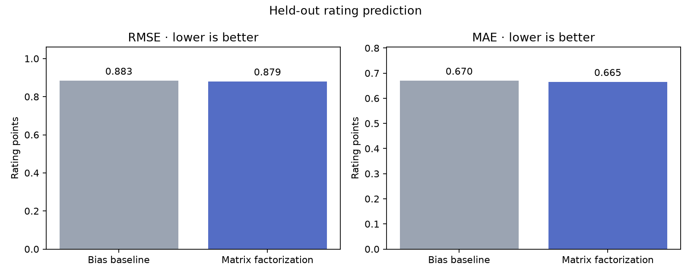
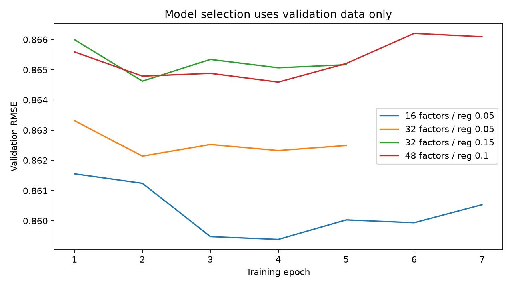

# Next Frame — Movie Recommendation Engine

B.Y.T.E Data Science Task 7: collaborative filtering with regularized, biased matrix factorization. Get five recommendations for a dataset user, or rate at least three films to create a temporary visitor profile.

**[Open the live demo](https://tamargo-ds7-movie-recommendation.vercel.app/)** · [GitHub repository](https://github.com/jarrodfranktamargocics-ui/DS_7_MovieRecommendationEngine_byte)

Deployed on Vercel from the `master` branch on October 23, 2026. The static site serves the saved `web/` artifacts; model training remains a local Python workflow.

## Dataset and scope

[MovieLens 32M](https://grouplens.org/datasets/movielens/32m/), from GroupLens, contains 32,000,204 ratings. Ratings end **October 12, 2023**. This project does not claim coverage of 2026 releases or every 2023 film.

The source was downloaded and verified on October 2, 2026. `prepare.py` checks the published checksums, selects 5,000 users with seed 42, and retains all their 779,802 ratings. Source checksums, collection time and sample SHA-256 are recorded in `outputs/metrics.json`. The original dataset terms and citation are preserved in `DATASET_LICENSE.txt`; they also apply to redistributed dataset-derived artifacts. This is an educational, noncommercial demonstration. See those terms before reuse.

Citation: F. Maxwell Harper and Joseph A. Konstan. 2015. The MovieLens Datasets: History and Context. ACM Transactions on Interactive Intelligent Systems 5, 4, Article 19. https://doi.org/10.1145/2827872

## Run the website first (no training needed)

Install Python 3.12 or newer. Download or clone this repository, open a terminal in its folder, and run:

```powershell
python -m http.server 8007 --directory web --bind 127.0.0.1
```

Open **http://127.0.0.1:8007/** in your browser. Keep the terminal open; press Ctrl+C to stop the website. Do not double-click the HTML file: the browser needs HTTP to load the saved model.

The saved model is already included. Open **My Recommendations**, rate at least three films, and click **Find my recommendations**. Alternatively, expand **Explore a dataset user instead**. Visitor ratings stay in this tab's session storage across refreshes; **Clear my ratings** removes them.

The local site now has seven pages: Home, Discover, My Recommendations, Movie Details, Data Explorer, Model Performance and About. It uses a dark cinema design with movie-specific charts and filters. No game data or scores feed the movie website. The saved browser model supports static hosting on Vercel without server-side training.

The trained catalogue has **34 titles dated 2023**, but none meets the current **20 training ratings** threshold for recommendation candidates. They remain browsable. This is sample/training coverage, not complete 2023 coverage. The publisher's cutoff is October 12, 2023; conversion of the sampled Unix timestamps to UTC reaches October 13 at the day boundary.

The Data Explorer shows sampled rating distributions and activity, trained-film genres and release years, a genre/decade heatmap, and training-rating-count versus average-star scatter plots. Model Performance retains the actual baseline, factor-model and ranking results. Every chart has a data table and CSV export control.

## Cinema design and posters

All seven pages use a dark cinema theme with poster-led browsing, editorial banners, genre shortcuts and a star-rating onboarding flow. Half-star ratings remain available through the precise-rating selector. A progress indicator enables the quick recommendation action after three films.

`build_explorer.py` reads the original MovieLens `links.csv` from the downloaded archive and exports IMDb identifiers for all 19,615 trained catalogue entries. Posters are loaded lazily from the public IMDb-addressed image URLs documented in the [Stremio metadata guide](https://stremio.github.io/stremio-addon-guide/step4), using Cinemeta/MetaHub. Matching is by source ID, never an approximate title search. There is no API secret in the browser and no bulk image download. This does not guarantee that an image exists or loads for every entry; failed requests display a designed title cover. Header collages load a small selection eagerly.

Images belong to their respective owners, and the site includes source attribution. The external image host receives ordinary image requests, not visitor ratings. Network access is required for posters; filtering, local model inference and fallback covers continue without them. Availability and provider requirements can change. Poster images do not enter model training or alter the recorded evaluation results.

## Reproduce the analysis

In Windows PowerShell, from this project folder:

```powershell
py -3.12 -m venv .venv
.\.venv\Scripts\python.exe -m pip install -r requirements.txt
.\.venv\Scripts\python.exe prepare.py
.\.venv\Scripts\python.exe train.py
.\.venv\Scripts\python.exe evaluate_ranking.py
.\.venv\Scripts\python.exe tune_ranking.py
.\.venv\Scripts\python.exe export_ranking.py
.\.venv\Scripts\python.exe build_neighbors.py
.\.venv\Scripts\python.exe verify.py
.\.venv\Scripts\python.exe make_notebook.py
.\.venv\Scripts\python.exe build_explorer.py
.\.venv\Scripts\python.exe build_web.py
```

The first preparation downloads about 239 MB; allow extra disk space for extracted CSVs. Training is local and may take several minutes. No Reddit account, API key, or paid service is required. Explicitly using the environment's Python avoids PowerShell activation-policy issues.

Open `notebooks/movie_recommendations.ipynb` in VS Code with its Jupyter extension to read the executed analysis. The notebook shows preprocessing and model source, selection results, evaluation charts and recommendations for three users. The commands above run training; regenerating the notebook displays the saved experiment rather than silently training again.

For an individual sampled user, run `recommend.py --user ID`, replacing ID with one of the IDs in `outputs/sample_recommendations.json`. The script prints the top five unseen supported films. IDs outside the sampled users are not available.

If Node.js is installed, also run `node test_browser.mjs`. This verifies the browser's top-five results against Python for all three examples and checks visitor profile fitting against an independent NumPy solution.

## How it works

1. Sort each user's ratings by timestamp, using movie ID to break ties. Split chronologically into training (621,912), validation (77,655), and test (80,235) rows. Learn user/movie mappings only from training. Missing ratings are unknown, not zero-star reviews.
2. Fit a regularized user/movie-bias baseline. Train four matrix-factorization configurations using stochastic gradient descent on observed ratings. Predict `global mean + user bias + movie bias + user factors · movie factors`.
3. Select factor count, regularization and stopping epoch using validation RMSE only. The selected model has 16 factors, regularization 0.05, and four epochs. Evaluate the test set after this selection. The exported model remains trained on the training partition.
4. Recommend only films with at least 20 training ratings, excluding the user's known rated movies. The website includes three example profiles; the Python script supports all 5,000 sampled users. The browser exports all 19,615 learned movie profiles, with the support threshold applied to searchable/recommended movies.
5. For new visitors, hold movie factors fixed and estimate a user bias and vector with ridge least squares (regularization 1). This is a practical onboarding heuristic; its accuracy has not been separately evaluated.
6. The updated serving order uses the **unclipped MF estimate + 1.6 × log(1 + training rating count)**. Seven weights (0, 0.05, 0.1, 0.2, 0.4, 0.8, 1.6) were compared on 500 validation users, selecting the highest NDCG@5 and preferring smaller weights on ties. Freeze this choice before test evaluation. Displayed stars still use the original clipped MF estimate, so the ordered list need not descend by displayed stars. This is a popularity/support adjustment to matrix factorization, not a new rating-prediction model.

## Results and their limits

Lower rating error is better. These are rating points on the 0.5–5 scale, **not accuracy percentages**.

| Test rating prediction | RMSE | MAE |
| --- | ---: | ---: |
| Regularized user/movie-bias baseline | 0.88334 | 0.66956 |
| Matrix factorization | 0.87937 | 0.66452 |

The improvement is modest. There are 2,629 test ratings for movies absent from training; those use the global mean plus user bias as fallback.

An additional fixed-seed ranking audit evaluates 200 users with at least one test rating of four stars or higher. It ranks all supported candidates, excludes training/validation history, and measures recovery of those held-out positive ratings. Higher is better here.

| Top-five ranking audit | Precision@5 | Recall@5 | NDCG@5 |
| --- | ---: | ---: | ---: |
| Bayesian movie-average baseline | 0.02400 | 0.01662 | 0.02986 |
| Matrix factorization | 0.00900 | 0.00753 | 0.00863 |

**The factor model does not beat the ranking baseline.** Slightly better star-rating predictions do not guarantee a better top-five list. These exploratory results are reported rather than used for further test-set tuning. Unknown/unrated items have unknown relevance, so these are sparse observed-feedback metrics, not a measure of visitor satisfaction. The ranking baseline differs from the rating-error baseline.

### Updated recommendation ranking

The table above preserves the original experiment. The new ranker keeps the trained matrix-factorization model and adds a validation-selected support bonus. Task 7 still uses sparse user–movie ratings, matrix factorization, User ID input, five predictions, RMSE/MAE, and three reproducible sample users.

| Historical test audit, same 200 users | Precision@5 | Recall@5 | NDCG@5 |
| --- | ---: | ---: | ---: |
| Original MF | 0.00900 | 0.00753 | 0.00863 |
| Bayesian movie average | 0.02400 | 0.01662 | 0.02986 |
| Most rated | 0.03500 | 0.03497 | 0.05171 |
| **Support-aware MF (deployed locally)** | **0.03900** | **0.03386** | **0.05462** |

The improved method beats original MF and the movie-average baseline on all three measures. Against the stronger most-rated baseline, precision and NDCG are slightly higher but recall is lower. These descriptive differences do not establish statistical significance. Much of the improvement comes from popularity; it can reduce novelty and does not establish high-quality personalization. RMSE/MAE remain unchanged because the star estimator was not retrained.

Selection uses **validation NDCG only**, with seed 7301. Test uses the same historical 200-user cohort and seed 2026 as the previous audit; it is **not a fresh untouched benchmark**. All methods share candidates, exclusions and relevance definitions. Known positives for unavailable movies remain in the recall denominator. The candidate pool has no exposure data, and unmatched suggestions may still be enjoyable. Visitor onboarding performance remains unevaluated. A separate future dataset is needed for a stronger generalization claim.

Reproduce with `tune_ranking.py`, then `export_ranking.py` to update browser serving and the three Python examples. After any new base-model training, rerun both steps; do not reuse old ranking calibration with different factors. The notebook and Model Performance page show validation selection and all four test comparisons.

### New-visitor personalization fix

The known-user ranking rule above is **not used for visitor profiles with likes**. With only three ratings, the old ridge fold-in often favored the same high-bias films; clipping personal predictions to 5 also made different scores appear identical. A large popularity bonus would not fix that sparse-profile problem.

`build_neighbors.py` now computes adjusted-cosine item similarities from **training ratings only**, subtracting each user's training mean. Require 10 shared raters, shrink similarity by `n/(n+25)`, and retain the top 80 positive neighbours for each supported film. Movie titles and genres do not determine those similarities.

For visitors, each rating contributes `rating - 3` times a movie similarity. Likes raise related movies; dislikes penalize them. Divide the summed contribution by total absolute preference weight, then add a smaller MF personal component (coefficient 0.02 after RMS scaling across candidates). These are fixed engineering settings, not validation-selected hyperparameters. If no films are liked, show explicitly labelled exploratory picks using adjusted audience averages, modest support and dislike penalties. Include at least one liked film for a meaningful taste direction.

Visitor cards show **training audience averages**, not uncalibrated personal star predictions. A short explanation names the liked seed with the strongest positive similarity contribution. Dataset-user examples still expose MF predicted ratings and use the evaluated support-aware ranker. The three-user Task 7 script and RMSE/MAE deliverables remain intact.

`node test_personalization.mjs` checks contrasting action/family tastes, rating inversion, exclusions and finite unique results. This is functional verification, **not held-out visitor-quality evaluation**; the existing ranking table must not be presented as performance of this visitor hybrid.

### Genre preferences and filters

Visitor ranking now adds a signed genre-similarity term: Jaccard overlap between each candidate and rated movie, weighted by `rating - 3`, divided by total absolute preference weight. The coefficient is 0.08 for “For your taste”, 0 for “Audience patterns”, and 0.2 for “More like my genres”. These are engineering choices, not validation-selected settings. Existing held-out metrics do not evaluate this visitor hybrid.

Hard filters select an included genre, excluded genre, animation only/excluded, and release-year bounds (1874–2023). Included genres use any movie containing that label; excluded genres take precedence. Unknown release years are excluded when a year bound is active. Filters never reintroduce seen or unsupported films, and may return fewer than five or no movies. The unfiltered User ID script still returns five. Dataset-user examples apply filters but do not use visitor genre scores.

Matching explanations disclose shared genres only when their net contribution is positive. Genre metadata comes from MovieLens. No title-based franchise guesses are made. Director, production studio and verified collection metadata are not yet included; a possible future source is the authenticated [TMDB API](https://developer.themoviedb.org/docs/authentication-application). No API credentials are embedded in this project.



Other limits: per-user time splits are not a globally prospective backtest; sampling limits coverage; the support threshold favors popular films; clipped predictions can tie; and the reported errors evaluate established users, not new visitors. Modern films need new interaction data or a separately evaluated content-based extension.




## Where the code and trained model live

- `prepare.py`: download, checksums, sampling and splits.
- `model.py` / `train.py`: matrix factorization and experiment/export pipeline.
- `outputs/model.npz`: trained Python model (numeric arrays, loaded without pickle).
- `web/model.json`: browser-ready factors, examples and recorded metrics.
- `recommend.py`: five recommendations for a sampled user ID.
- `evaluate_ranking.py`: supplementary ranking audit.
- `tune_ranking.py`: validation-only ranking-weight selection, historical test comparison and exported chart.
- `export_ranking.py`: attach the selected ranking rule to the browser model and regenerate three sample users.
- `build_neighbors.py`: training-only collaborative movie neighbours for visitor personalization.
- `test_personalization.mjs`: behavioural regression checks for contrasting visitor tastes.
- `outputs/ranking_config.json`: selected serving rule; `outputs/ranking_improvement.json`: validation and test results.
- `outputs/`: metrics, candidate results, charts and sample recommendations.
- `notebooks/movie_recommendations.ipynb`: executed analysis.
- `web/engine.js`: browser scoring and visitor profile fitting.
- `build_explorer.py`: rebuild chart aggregates from the existing sample and recorded model outputs.
- `build_web.py`: regenerate the seven page templates.
- `web/dashboard.js`, `web/charts.js`: multi-page behavior, movie charts and filtering.
- `web/cinema.js`, `web/cinema.css`: poster loading/fallbacks, cinema styling, genre shortcuts and star controls.
- `verify.py` / `test_browser.mjs`: split and inference checks.

## Publish with GitHub and Vercel

Create a public repository named **DS_7_MovieRecommendationEngine_byte** and upload this project's files. Keep `data/`, `.venv/` and `.runtime/` out of Git; `.gitignore` handles them. Include the saved outputs, notebook and `web/` artifacts so deployment needs no training.

In Vercel, choose **Add New → Project**, import that repository, and use the **Other** framework preset. Keep the root directory at the repository root, set the output directory to **web**, and leave build/install commands empty. The included `vercel.json` supplies the static configuration. Deploy, open the generated URL, and test both recommendation modes. No environment variables are needed. Later commits to the connected production branch trigger another deployment.

Author: Jarrod Frank Tamargo — [GitHub](https://github.com/jarrodfranktamargocics-ui).


